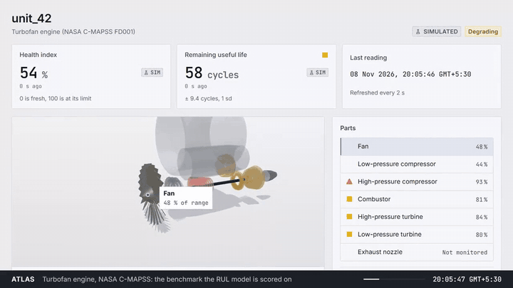
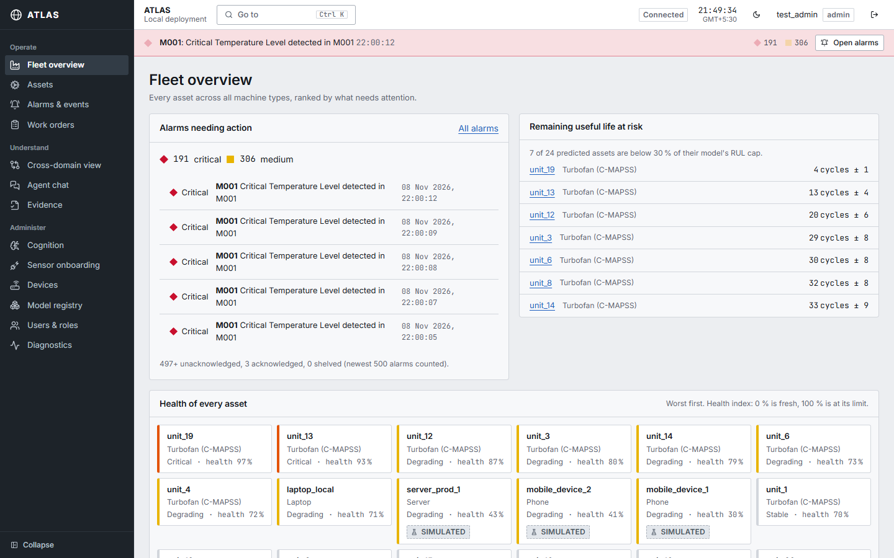

# ATLAS

**An Adaptive Machine Cognition Platform for Explainable Predictive Maintenance Across Heterogeneous Machine Systems**

ATLAS connects unlike machines (a turbofan, a laptop, a phone, a server, a Modbus pump) through one adapter layer, predicts their remaining useful life with an attention LSTM, grounds every prediction in similar past cases, simulates the cost of each maintenance action, and puts the result in front of an operator who decides.

[](https://github.com/YMP7/Predictive-Maintenance-AI/actions/workflows/ci.yml)





---

## What the title means, and the numbers behind it

| Term | What you can see | The number |
|---|---|---|
| Adaptive | Adaptive Context and Learning Engine panels in Cognition; Model registry | Borrowing turbofan memory inflates phone error 8.3x and server 7.1x, so each domain adapts with its own |
| Machine Cognition | Cognition: all ten pipeline stages with latency and replay | 21.8 ms end to end on C-MAPSS; 47% lower maintenance cost than a RUL-threshold rule (ablation) |
| Platform | Seven-step sensor onboarding, devices, roles, audit | 41/41 adapter conformance tests; onboarded sensor's data on screen in 0.6 s |
| Explainable | "Show why" in the 3D Asset View; attribution and AMKB citations | Masking the top-2 attributed sensors moves RUL 35.4 cycles vs 16.8 for random ones (90% of 100 test units) |
| Predictive Maintenance | Asset Detail RUL band, recommended action, work orders | NASA C-MAPSS FD001: RMSE 15.42, PHM 394.7 (five seeds: 15.22 ± 0.30) |
| Heterogeneous Machine Systems | Cross-domain view; five machines in 3D | Five trained domains: turbofan on the NASA benchmark; laptop, phone, server and Modbus pump on simulated data (pump RMSE 7.72 cycles on simulated failures) |

Every cell, with file paths, endpoints and the command that reproduces it: [docs/TITLE_JUSTIFICATION.md](docs/TITLE_JUSTIFICATION.md). The same matrix is the product page `/about/evidence`. What is not done is marked FUTURE-WORK there, not hidden.

---

## The product

| Page | For | What it does |
|---|---|---|
| Fleet overview `/fleet` | everyone | Health of every asset, alarms needing action, RUL at risk, ingestion health |
| Assets `/assets` | everyone | 3D Asset View per machine: explode, cutaway, part loads, Show why, live trends, RUL band, recommended action |
| Alarms `/alarms` | everyone (operators act) | ISA-18.2 list: acknowledge, shelve with reason and time limit, clear; flood indicator |
| Work orders `/work-orders` | everyone (operators act) | Create, approve, reject, assign, start, resolve |
| Cross-domain `/cross-domain` | everyone | All machines on one normalised scale |
| Agent chat `/chat` | operators, admins | Ask about a machine; AMKB evidence beside each answer |
| Evidence `/about/evidence` | everyone | The title matrix with live numbers |
| Cognition `/admin/cognition` | admins | The pipeline stage by stage, replay, drift, fleet cognition health |
| Model registry `/admin/models` | admins | Versions, promote and roll back, retrain |
| Onboarding, Devices, Users, Diagnostics `/admin/*` | admins | Connect a sensor, rotate tokens, change roles, platform health |

Kiosk mode (`?kiosk=1`) runs a hands-free tour for a wall screen. Screens of every page, light and dark: `docs/media/screens/`.

---

## Architecture

```
 Turbofan (C-MAPSS replay)  Laptop  Phone  Server (SSH)  Modbus pump  Any device (HTTP, WebSocket, MQTT, CSV, manual)
            │                  │      │         │             │                 │
            └──────────────────┴──────┴─────────┴─────────────┴─────────────────┘
                                   Adapter Layer (server/adapters/)
                      normalised readings with units, valid ranges and quality flags
                                              │
       World Model (attention LSTM, 32-dim state) ─► AMKB memory ◄─► Machine DNA (16-dim)
                                              │
              Adaptive Context ─► RUL ─► Monte Carlo simulation ─► Decision Graph ─► Explanation
                                              │
     FastAPI (RBAC, rate limits, audit middleware) ─► TimescaleDB (readings, alarms, work orders, audit)
                                              │
                    React app: Fleet, Assets (3D), Alarms, Work orders, Cognition, Evidence
```

The full diagram is [docs/figures/atlas-architecture.svg](docs/figures/atlas-architecture.svg). Design decisions are recorded in [docs/redesign/DECISIONS.md](docs/redesign/DECISIONS.md), changes in [docs/redesign/CHANGELOG.md](docs/redesign/CHANGELOG.md).

---

## Quick start

### 1. Configure
```bash
cp .env.example .env
openssl rand -hex 32
```
Put the hex string in `.env` as `JWT_SECRET_KEY` (the server refuses to start without it). Also set `TSDB_PASSWORD`, `DATABASE_URL` (e.g. `postgresql://dtwin:<password>@localhost:5433/digital_twin`), `ADMIN_PASSWORD_HASH` and `OPERATOR_PASSWORD_HASH`. `ATLAS_APP_DB_PASSWORD` enables the non-owner database role the API should use (see [docs/AUDIT_TRAIL.md](docs/AUDIT_TRAIL.md)).

### 2. Start the database and broker
```bash
python scripts/generate_mqtt_passwords.py
docker compose up -d timescaledb mosquitto
```

### 3. Create tables and development accounts
```bash
python scripts/migrate.py
python scripts/migrate_atlas.py
python scripts/migrate_platform.py
python scripts/seed_dev.py
```
`seed_dev.py` creates development accounts with publicly known passwords. Never run it against a deployed database.

### 4. Start the backend
```bash
pip install -r requirements.txt
pip install -r requirements-ml.txt --extra-index-url https://download.pytorch.org/whl/cpu
PYTHONPATH=. python server/integrated_server.py
```

### 5. Start the frontend
```bash
cd client
npm ci
npm run dev
```
Open `http://localhost:3000`. The dev server proxies `/api` to `http://localhost:8000`; set `ATLAS_API_TARGET` to point it elsewhere.

---

## Tests

```bash
python -m pytest tests/ -q
python scripts/audit_verify.py
cd client && npm run e2e
```
The backend suite runs against a local TimescaleDB. The Playwright flows (`client/e2e/`) need the backend and the dev server running; they sign in with the seeded test accounts. The 3D view's performance and leak checks are described in [docs/redesign/03_3D_DECISION.md](docs/redesign/03_3D_DECISION.md).

Guides: [user guide](docs/USER_GUIDE.md), [administrator guide](docs/ADMIN_GUIDE.md), [audit trail](docs/AUDIT_TRAIL.md), [adapter SDK](docs/ADAPTER_SDK_SPEC.md), [reproducibility](docs/REPRODUCIBILITY.md).

---

## Security

- Session JWT in an HttpOnly, SameSite=Lax cookie, plus an anti-CSRF header on every API call; `Secure` is set when `ENVIRONMENT` is not `development`.
- Roles: admin, operator, viewer, enforced on the server; every `/api/admin/*` path is admin-only.
- Device tokens are shown once and stored only as SHA-256 hashes; rotate or revoke them on the Devices page.
- Every request, sign-in, alarm action, work-order change, model change and UI command is written to a hash-chained, append-only audit trail ([docs/AUDIT_TRAIL.md](docs/AUDIT_TRAIL.md)).
- `CORS_ORIGINS=*` is rejected at start-up. Mosquitto ACLs restrict each device to its own topic.

See [SECURITY.md](SECURITY.md) for vulnerability reporting. HTTPS deployment needs a domain and is not set up yet.

---

## License

Licensed under the [Apache License 2.0](LICENSE). Versions published before 2026-10-09 were released under MIT. See [docs/LICENSE_OPTIONS.md](docs/LICENSE_OPTIONS.md).
