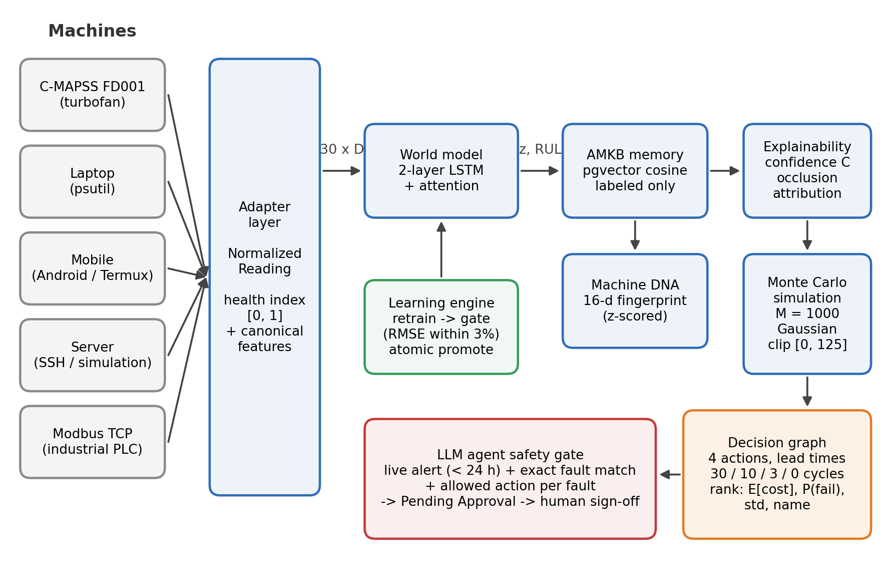
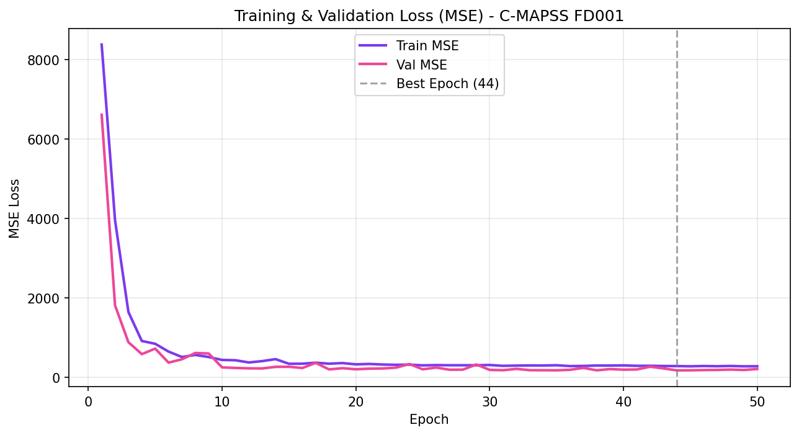
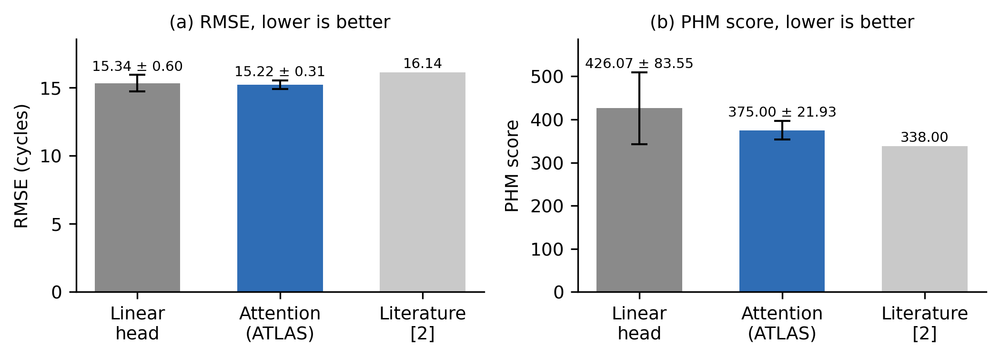
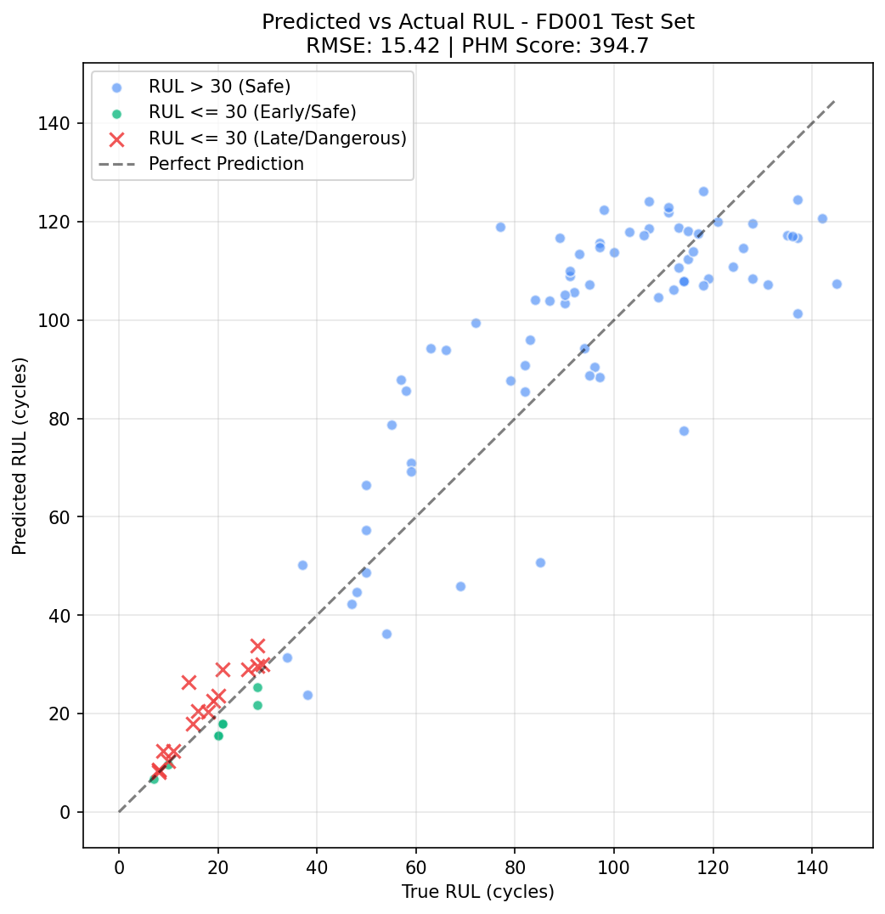
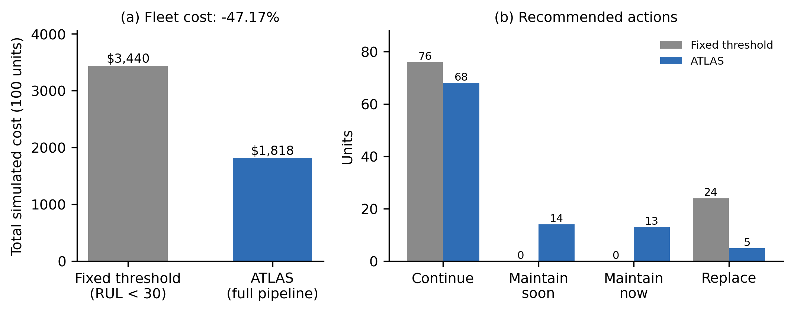
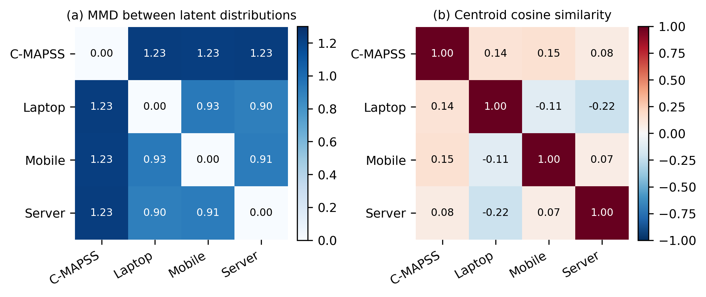
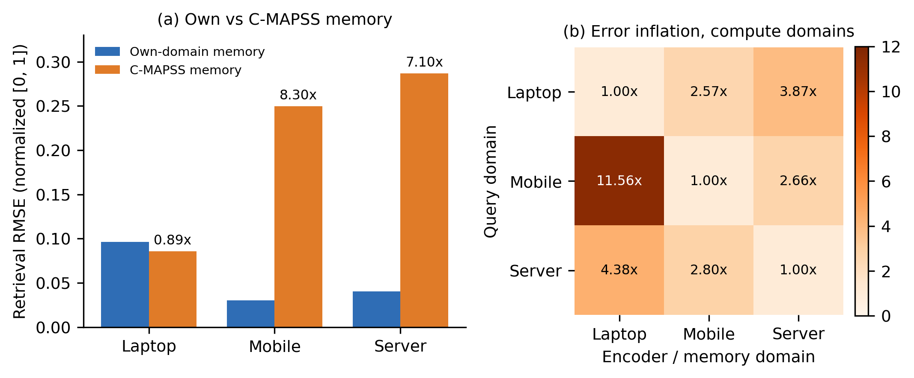
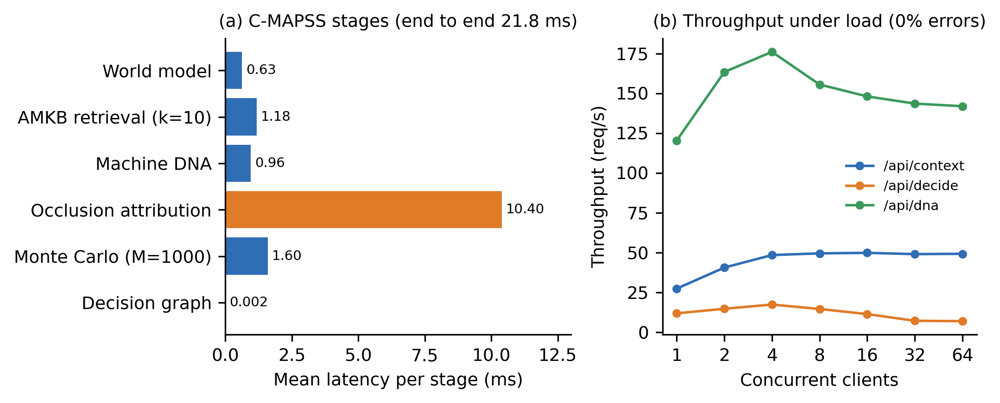

# ATLAS: An Adaptive Machine Cognition Platform for Explainable Predictive Maintenance Across Heterogeneous Machine Systems

**Authors:** \[Author\] · \[Supervisor\] · \[Department, Institution\]

**Status:** DRAFT v0.2, private. Do not post, upload, or submit anywhere until IP clearance is confirmed (see Availability).

## Abstract

Predictive-maintenance systems usually stop at estimating remaining useful life (RUL), leaving two questions open: what should be done about the estimate, and why should an operator trust it? We present ATLAS, a modular platform that couples RUL prediction with memory-grounded explanation and cost-aware decision support, and that runs unchanged on different machines through a thin adapter layer. A recurrent world model with additive temporal attention encodes sensor windows into a shared 32-dimensional state; a vector-indexed memory of labeled run-to-failure experiences supplies neighbor citations, a calibrated confidence score and an uncertainty proxy; a Monte Carlo decision graph ranks four maintenance actions by expected cost under action-specific lead times. On NASA C-MAPSS FD001 the prediction engine reaches RMSE 15.22 ± 0.31 and PHM score 375.0 ± 21.9 over five seeds (a published LSTM baseline reports RMSE 16.14). Ablations show a 47.2% reduction in simulated fleet cost against a fixed-threshold rule with no missed imminent failures, and a rank correlation of −0.51 between grounded confidence and absolute error. Applying the same architecture to laptop, mobile and server telemetry, a cross-domain study (MMD, centroid similarity, retrieval error inflation) shows that learned representations are domain-specific: cross-domain memory retrieval inflates error 7–8x for two of three domains, and the third is explained by a boundary-regression artifact rather than transfer. We also report 13 defects found during development, nearly all sharing one signature (plausible output computed by the wrong method), and the regression guards that now prevent them.

**Keywords:** predictive maintenance; remaining useful life; explainable AI; decision support; digital twin; cross-domain representation; industrial IoT.

## 1. Introduction

Unplanned equipment failure is costly, and most deployed predictive-maintenance (PdM) systems stop at an RUL estimate or a threshold alarm. Operators are left with two questions: what to do about the estimate, given its uncertainty and the cost of acting too early or too late, and why the estimate should be trusted. Published RUL work on benchmarks such as NASA C-MAPSS \[1\] concentrates on point-prediction accuracy \[2\]-\[4\]. Interpretable and decision-aware variants exist \[5\], but they are typically evaluated on one dataset and one machine type.

ATLAS addresses the gap between prediction and decision with one architecture that (i) predicts RUL, (ii) grounds each prediction in citations to labeled historical cases, (iii) ranks maintenance actions by simulated expected cost, and (iv) runs unchanged on different machines through an adapter layer. Our contributions are:

1. An integrated pipeline (world model, memory, explanation, Monte Carlo decision graph) evaluated end to end on C-MAPSS FD001 with multi-seed statistics.
2. A memory-grounding rule with a circularity guard: explanations may cite only neighbors that carry ground-truth labels, never the model's own predictions.
3. A lead-time-aware decision model whose ranking is deterministic and breaks ties toward the safer action.
4. A four-domain study (turbofan, laptop, mobile, server) showing, with a distribution-distance metric and a retrieval-based diagnostic, that learned representations are domain-specific, including an honest account of one result that looks like positive transfer but is not.
5. A verification methodology and defect catalogue (13 defects, 2 near-misses) with the regression guards that prevent each, and an adapter SDK whose conformance suite enforces those guards for new machine types.

We do not claim state-of-the-art RUL accuracy, validation on real run-to-failure data outside C-MAPSS, or production readiness (Section 7).

## 2. Related Work

**RUL prediction.** C-MAPSS \[1\] is the standard turbofan degradation benchmark and defines the asymmetric PHM score. Recurrent models set early baselines (an LSTM reports RMSE 16.14 on FD001 \[2\]); attention and transformer variants followed \[3\], \[4\]. Our prediction engine is deliberately simple (unidirectional LSTM with additive attention) because the contribution is the system around it.

**Interpretable and decision-aware PdM.** Closest to our scope is interpretable ensemble RUL prediction coupled with cost-aware scheduling on C-MAPSS \[5\]. ATLAS differs in grounding explanations in a labeled case memory, in modelling action-specific lead times with Monte Carlo sampling, and in the multi-domain adapter design. Attribution uses perturbation (occlusion \[6\]) rather than SHAP \[7\] to stay model-agnostic and cheap on CPU. Retrieval of similar historical trajectories has a long history in similarity-based prognostics \[8\]; our use differs in the labeling rule and in using retrieval for confidence and uncertainty.

**Other datasets.** MetroPT \[9\] provides real compressor data from a metro system; we do not use it here and list it as a validation target.

**Cross-domain measurement.** We use maximum mean discrepancy (MMD) \[10\] and centroid similarity as diagnostics, not as an adaptation method. Transfer-component approaches \[11\] are related but train for invariance, which we do not.

## 3. System Design

### 3.1 Adapter layer and canonical features

Every machine is reached through an adapter that returns a normalized reading: domain, machine id, timestamp, a health index in \[0, 1\], a feature dictionary, raw channels and an optional ground-truth RUL label. Adapters report their own feature count and nothing downstream assumes one. Each domain's encoder consumes a fixed canonical subset: 14 informative sensors for C-MAPSS (7 near-constant sensors are dropped) and 5 features for each of laptop, mobile and server. Mobile acquires 16 channels (14 sensed, 2 derived norms) and laptop 16 (5 model inputs, 11 diagnostic channels, one of them a heuristic thermal estimate). Only the canonical 5 reach the model, and channels are labeled measured, derived or heuristic in the interface. Figure 1 shows the end-to-end architecture.

**Figure 1.** ATLAS architecture. Adapters normalize each machine's telemetry into a canonical window. The world model produces a 32-dimensional state and an RUL estimate; memory, Machine DNA and explainability ground the estimate; Monte Carlo simulation and the decision graph rank maintenance actions. The language-model agent can raise work orders only through the safety gate, and every order waits for human approval.

The health index has two documented meanings. For C-MAPSS (Category A) it is degradation toward failure. For the compute domains (Category B) it is instantaneous operational stress, a load proxy that is not a wear signal. Cross-domain comparisons are interpreted with this difference in mind.

### 3.2 World model

A window of 30 steps with D canonical features passes through a two-layer LSTM (hidden size 64), giving states h\_1..h\_30. Additive attention \[12\] computes e\_t = vᵀ tanh(W h\_t + b), α = softmax(e) and context c = Σ\_t α\_t h\_t. A linear projection gives a 32-dimensional state z, and a linear head gives the RUL estimate with no terminal nonlinearity; non-negativity is imposed by clamping at inference. RUL targets are clipped at 125 cycles. Training uses mean-squared error with Adam, a unit-level 80/20 train/validation split, early stopping on validation loss, and one evaluation on the official test set using the last window of each test unit. Figure 2 shows training and validation loss for one run.

**Figure 2.** Training and validation MSE on C-MAPSS FD001 for one training run. The checkpoint with the lowest validation loss (epoch 44) is kept.

### 3.3 Adaptive Machine Knowledge Base (AMKB)

Experiences are stored in a vector index (pgvector, cosine distance) with domain, machine id, cycle, the 32-d state, the clipped RUL label used for scoring, the raw RUL in metadata and, separately, the model's predicted RUL. Retrieval excludes the query's own record (machine id and cycle). Only experiences with ground-truth labels may be cited.

### 3.4 Machine DNA

A 16-dimensional per-unit fingerprint summarizes degradation character: three whole-life health-pattern terms (slope of the state norm; slope and variance of an unclipped life-fraction health signal), three thermal and two speed sensor slopes over the whole life, and eight terminal terms (slopes of health, state norm and six degradation-sensitive sensors over the final 20% of life). Each dimension is z-scored over the unit population, with the statistics persisted and applied identically to stored and query vectors. The unclipped life-fraction signal avoids a confound: with RUL clipped at 125, long-lived units would show a flat health region that reflects lifespan rather than degradation shape.

### 3.5 Explainability

Confidence is C = \[1/(1 + d̄)\] · \[1/(1 + σ²)\], where d̄ is the mean cosine distance to the retained neighbors and σ² the variance of their RUL labels; the additive constants bound both factors and remove division-by-zero failures. Attribution replaces each sensor channel over the whole window with a fixed reference value (0.0 in the normalized space), re-runs the model and records the signed change in the RUL estimate; channels are ranked by magnitude with ties broken by channel index. Explanation text is template-based, not generated by a language model.

### 3.6 Simulation and decision graph

Given estimate μ and neighbor-label variance σ², M = 1,000 samples are drawn from a Gaussian centered at μ with variance σ² and clipped to \[0, 125\]. Four actions are evaluated: continue operation, schedule maintenance soon, schedule maintenance now, and replace immediately, with lead times of 30 (a risk-exposure horizon), 10, 3 and 0 cycles. For sample y and action a, the cost is C\_fail = 1000 if y ≤ lead(a); otherwise 0 for continuing, and C\_base + C\_down · u(a) for the others (C\_base = 50, C\_down = 5, u = 1, 1.5, 2). These parameters are illustrative and not fitted to financial data. Actions are ranked by expected cost, then failure probability, then cost standard deviation, then action name, so a tie never silently favors inaction.

### 3.7 Learning engine

Retraining produces a candidate model that is evaluated on a held-out set. It replaces the active checkpoint only if its RMSE is within 3% of the baseline (the tolerance reflects the 2-4% seed variance we measured). Promotion is an atomic file replacement, every run is written to an audit table, and a rejected run leaves the active weights byte-identical.

### 3.8 Agent safety gate

A language-model assistant can propose maintenance work orders only through a structured tool. The tool requires an alert id that exists for that machine, comes from the automated pipeline, is under 24 hours old and meets a severity threshold. The declared fault type (from a closed enumeration) must equal the alert's fault type exactly, the requested action must belong to a per-fault allowed list, and the creator is stamped server-side from the authenticated context. Orders start as Pending Approval and become active only through a role-checked human approval. The agent has no function that actuates a machine. This closes a weakness we found initially, where keyword matching let an eloquent justification ground an unrelated action.

## 4. Experimental Setup

**Data.** C-MAPSS FD001 (100 training and 100 test engines, one operating condition, one fault mode) \[1\]. Laptop and mobile data come from our adapters (psutil; Android via Termux). The server domain runs a calibrated simulation by default, with an SSH collection path implemented but not exercised on real cloud hardware. Compute-domain encoders are pretrained by self-supervised next-step prediction with an auxiliary stress target on simulation profiles calibrated to real adapter telemetry, so they are trained predominantly on simulated windows.

**Metrics.** RMSE and the asymmetric PHM score \[1\]: s = Σ(e^(−d/13) − 1) over early predictions and Σ(e^(d/10) − 1) over late ones, with d = predicted − true.

**Protocol.** Five seeds (42-46), each with its own unit split and initialization; mean ± standard deviation is reported. Experiments ran CPU-only on a single workstation. CPU training is not bit-reproducible, so a band of about ±0.3 RMSE should be expected on reruns.

## 5. Results

### 5.1 RUL prediction

| Model | RMSE | PHM score |
| --- | --- | --- |
| LSTM with linear head (5 seeds) | 15.34 ± 0.60 | 426.07 ± 83.55 |
| LSTM + additive attention (5 seeds) | 15.22 ± 0.31 | 375.00 ± 21.93 |
| LSTM baseline from the literature \[2\] | 16.14 | 338 |

An earlier single run (RMSE 15.02, PHM 383.19) was a favorable seed, which is why we report multi-seed statistics. Attention reduced the PHM coefficient of variation from 19.6% to 5.8%. Our RMSE is lower than \[2\], but our PHM score is higher than its reported value, meaning our errors skew later than theirs. The comparison is directional, not a controlled ablation, because implementations differ. Figure 3 compares the variants, and Figure 4 plots per-unit predictions for the evaluated checkpoint.

**Figure 3.** RUL accuracy on the FD001 test set, mean ± standard deviation over five seeds (42-46). The literature value [2] is a single reported number from a different implementation.

**Figure 4.** Predicted versus true RUL for the 100 FD001 test units (last window per unit) from the evaluated checkpoint (RMSE 15.42, PHM 394.7, within the five-seed band). Crosses mark units with true RUL ≤ 30 whose estimate is late.

### 5.2 Ablations (FD001 test set, 100 units, last-window protocol)

**Decision value.** Against a fixed rule (replace below a 30-cycle estimate, otherwise continue), the full pipeline cut total simulated cost from $3,440.00 to $1,817.50 (−47.17%), with no missed imminent failures (true RUL ≤ 5) under either policy. The graduated policy discarded 281 cycles of remaining life across 3 units that the fixed rule did not replace early. We report this as a cost of the approach: these were early-life states where retrieval was uninformative, neighbor variance was large, and Gaussian tail mass pushed borderline expected costs within 1-3% of each other. Figure 5 compares total cost and the action mix of both policies.

**Figure 5.** Decision-value ablation on the 100 FD001 test units. (a) Total simulated cost under the illustrative cost model. (b) Recommended actions per policy: ATLAS schedules maintenance for 27 units and replaces 5, where the fixed rule replaces 24.

**Grounding.** Grounded confidence correlates with absolute error at r\_s = −0.509 (higher confidence, lower error). An ungrounded constant confidence of 0.5 has no variance, so its correlation is undefined.

**Decision graph versus a threshold cascade.** The policies disagreed on 30 of 100 units, and ATLAS cost 10.46% less on that subset. On near-failure units (true RUL ≤ 15) both policies responded urgently 10 of 10 times, so the data show safety parity, not a safety advantage. One unit was scheduled with only a 4-cycle margin.

**Determinism caveat.** Seeding makes the reported numbers reproducible, but near-tied expected costs remain sensitive to Monte Carlo sampling in deployment. A margin below which the system defers to a human is a recommended safeguard.

### 5.3 Cross-domain study

MMD between C-MAPSS and each compute domain was about 1.23, against about 0.90-0.93 among the compute domains, so physical-degradation data separates cleanly from operational-load data. Centroid cosine similarities lay between −0.22 and 0.15: roughly orthogonal directions rather than clusters. Both matrices are shown in Figure 6.

**Figure 6.** Cross-domain distances in the learned latent space. (a) Maximum mean discrepancy: C-MAPSS is about 1.23 from every compute domain, against 0.90-0.93 among the compute domains. (b) Off-diagonal centroid cosine similarities lie between −0.22 and 0.15.

Retrieval diagnostic (RMSE on the normalized \[0, 1\] scale), querying a domain's embeddings against its own memory versus the C-MAPSS memory:

| Domain | Within | Cross (to C-MAPSS) | Ratio |
| --- | --- | --- | --- |
| Laptop | 0.0961 | 0.0858 | 0.89x |
| Mobile | 0.0301 | 0.2495 | 8.30x |
| Server | 0.0404 | 0.2868 | 7.10x |

Laptop's ratio below 1 is not evidence of beneficial transfer. Its within-domain baseline is the weakest (four workload regimes), and out-of-distribution queries regress toward the global label mean, which happens to lie near the laptop mean. The latent distance gap (0.28 within versus 10.82 across) confirms the queries are not semantically close. In a 3x3 compute-domain matrix every domain was best on its own encoder, with 2.57x-11.56x inflation elsewhere. Together these results support domain-specific encoders. An earlier version of this experiment zero-padded compute inputs into the C-MAPSS model; that tested dimensional mismatch, not transfer, and was discarded. Figure 7 summarizes both diagnostics.

**Figure 7.** Retrieval diagnostic. (a) Retrieval RMSE when each compute domain queries its own memory versus the C-MAPSS memory; labels give the inflation ratio. (b) Error inflation when a compute domain is queried against another compute domain's encoder and memory; every domain is best on its own (diagonal).

### 5.4 System performance

CPU-only single-request latency for C-MAPSS averaged 21.8 ms end to end (100 trials), and 6.7-10.5 ms for the compute domains. Occlusion attribution dominated at 10.4 ms (14 forward passes), followed by Monte Carlo simulation at 1.6 ms (Figure 8a). The isolated stages sum to 14.8 ms; most of the remaining 7.0 ms is inter-stage overhead, chiefly checkouts from two separate database connection pools. Throughput of the context endpoint plateaued near 49 requests/s at 4-8 clients, bound by a 3-slot connection pool, and the full decision endpoint peaked at 17.4 requests/s at 4 clients (Figure 8b). Isolated-process memory was about 282 MB.

**Figure 8.** System performance on CPU only. (a) Mean per-stage latency for one C-MAPSS request (100 trials); occlusion attribution dominates. (b) Throughput versus concurrent clients for three API endpoints, with no errors at any load level.

## 6. Verification Methodology and Defect Analysis

During development we logged 13 defects and 2 near-misses. Nearly all share one signature: a plausible-looking result computed by the wrong method. Examples: a terminal ReLU that zeroed RUL outputs for about half of random initializations; an evaluation protocol that scored all windows instead of the last window per unit, inflating a baseline RMSE to 48.8 against a true 15.4 and defeating a promotion gate; clipped and raw RUL scales mixed between subsystems; retrieval returning the query itself as its nearest neighbor; an alphabetical tie-break that could favor inaction; a cost model whose interventions ignored urgency; an inverted similarity/distance sign; a live API silently routing three domains to an untrained fallback although trained checkpoints existed; and an unauthenticated arbitrary file read (path traversal) in the static-file handler, found by an independent second review after our own security pass missed it.

Practices that caught these: cross-checking a claim against a second independent measurement; reading the raw artifact rather than a summary; one permanent regression test per defect; hard-coded thresholds in tests so a guard cannot be loosened together with the code it guards; a queryable trained-or-not flag per domain that turns silent untrained inference into an error; and labeling simulated, replayed, estimated and measured data distinctly. An adapter SDK conformance suite applies these checks to any new machine type.

## 7. Limitations and Threats to Validity

- One benchmark subset (FD001); multi-condition subsets and real run-to-failure data are untested.
- For laptop, mobile and server, the memory holds no real run-to-failure cases, encoders are trained predominantly on simulation, and the server path is simulated by default. Claims for these domains concern the architecture, not field accuracy.
- Health-index semantics differ between categories, so cross-domain similarity is a diagnostic, not proof of shared structure.
- The cost model is illustrative; savings are relative, not financial.
- Gaussian uncertainty is a simplification; no model-native predictive distribution is used yet.
- Domain-encoder results use one seed per domain; seed variance there is uncharacterized.
- The PHM score trails the cited baseline, and the literature comparison is directional.
- Agent grounding validates structure (ids, enumerations, allowed actions), not the truth of free-text rationale; human approval remains the final barrier.

## 8. Conclusion and Future Work

ATLAS shows that RUL prediction, memory-grounded explanation and cost-aware decisions can share one architecture across machine types, and that the main risks sit at the seams between components, which our verification practice targets. Next steps: MC-dropout and ensemble uncertainty, multi-seed domain encoders, multi-condition C-MAPSS, a high-frequency vibration domain, validation on real hardware (an industrial machine and a cloud VM), and a generalized adapter framework with protocol adapters (Modbus, OPC-UA).

## Availability

Code, benchmark artifacts and trained models: \[to be filled in after IP clearance and the license decision\].

## References

&#91;1\] A. Saxena, K. Goebel, D. Simon, N. Eklund, “Damage propagation modeling for aircraft engine run-to-failure simulation,” Proc. Int. Conf. Prognostics and Health Management, 2008.

&#91;2\] S. Zheng, K. Ristovski, A. Farahat, C. Gupta, “Long short-term memory network for remaining useful life estimation,” IEEE ICPHM, pp. 88-95, 2017.

&#91;3\] Z. Chen, M. Wu, R. Zhao, F. Guretno, R. Yan, X. Li, “Machine remaining useful life prediction via an attention-based deep learning approach,” IEEE Trans. Ind. Electron., vol. 68, no. 3, pp. 2521-2531, 2021.

&#91;4\] Q. Ma, M. Zhang, Y. Xu, J. Song, T. Zhang, “Remaining useful life estimation for turbofan engine with transformer-based deep architecture,” 26th Int. Conf. Automation and Computing (ICAC), IEEE, 2021, doi:10.23919/ICAC50006.2021.9594150.

&#91;5\] H. Özcan, “Interpretable ensemble RUL prediction enables dynamic maintenance scheduling for aircraft engines,” Scientific Reports, 2025, doi:10.1038/s41598-025-23473-2.

&#91;6\] M. D. Zeiler, R. Fergus, “Visualizing and understanding convolutional networks,” ECCV, 2014.

&#91;7\] S. M. Lundberg, S.-I. Lee, “A unified approach to interpreting model predictions,” NeurIPS, 2017.

&#91;8\] T. Wang, J. Yu, D. Siegel, J. Lee, “A similarity-based prognostics approach for remaining useful life estimation of engineered systems,” Proc. Int. Conf. PHM, 2008.

&#91;9\] B. Veloso, R. P. Ribeiro, J. Gama, P. M. Pereira, “The MetroPT dataset for predictive maintenance,” Scientific Data, 2022, doi:10.1038/s41597-022-01877-3.

&#91;10\] A. Gretton, K. M. Borgwardt, M. J. Rasch, B. Schölkopf, A. Smola, “A kernel two-sample test,” J. Mach. Learn. Res., vol. 13, pp. 723-773, 2012.

&#91;11\] S. J. Pan, I. W. Tsang, J. T. Kwok, Q. Yang, “Domain adaptation via transfer component analysis,” IEEE Trans. Neural Netw., vol. 22, no. 2, pp. 199-210, 2011.

&#91;12\] D. Bahdanau, K. Cho, Y. Bengio, “Neural machine translation by jointly learning to align and translate,” ICLR, 2015.

**These references were written from memory of the literature plus the project's earlier checks. Open each source and confirm authors, year, venue and every number cited before submission.**

## Appendix A. Author checklist: re-pull every number

| Claim in this paper | Where to re-pull it |
| --- | --- |
| Section 5.1 RMSE and PHM table | data/atlas\_evaluation\_summary.json and the five-seed logs |
| Zheng et al. RMSE 16.14 and PHM 338 | the paper itself \[2\] |
| Section 5.2 ablation figures | data/ablation\_results.json |
| Section 5.3 MMD, cosine and retrieval tables | docs/TRANSFER\_STUDY\_RESULTS.md and the study JSON |
| Section 5.4 latency, throughput, memory | data/system\_benchmark\_results.json, data/system\_resource\_profile.json |
| Defect counts and examples | docs/qa/DEFECT\_REPORTS.md |
| Attribution reference value of 0.0 | confirm which normalizer is in use (standardization or min-max) |
| Lead times, cost parameters, 3% gate | server/atlas/simulation.py and learning\_engine.py |
