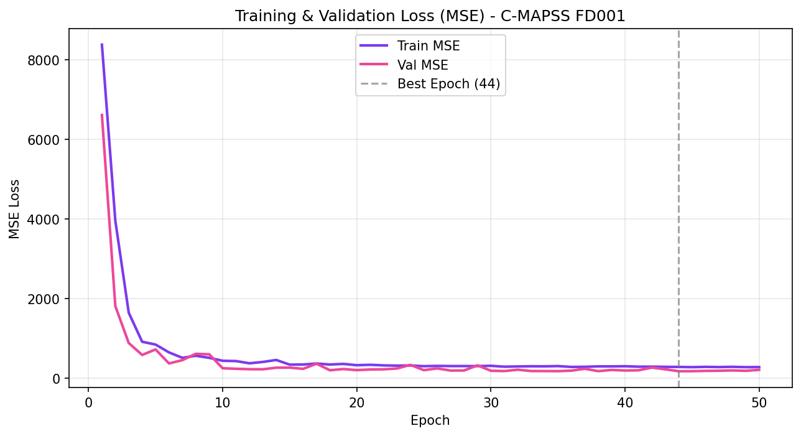
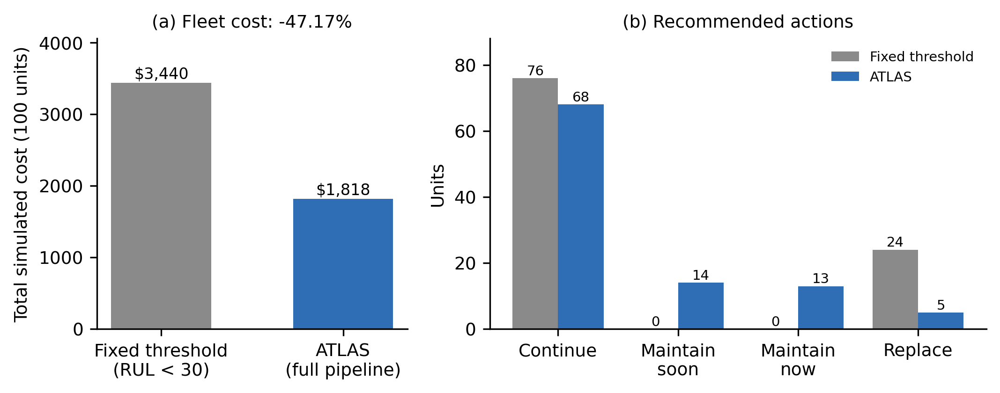
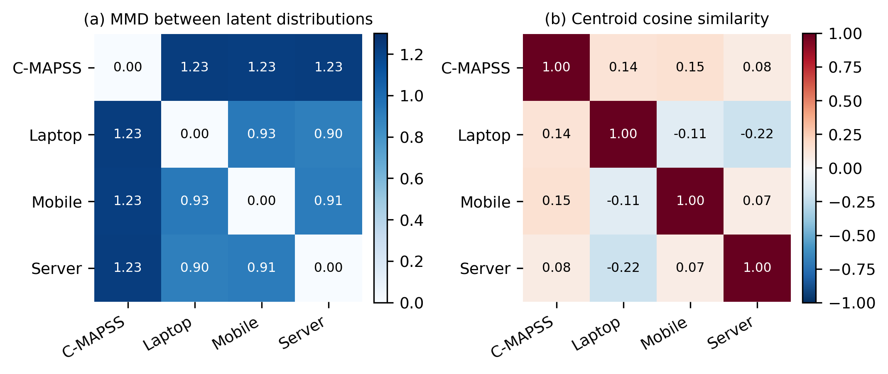
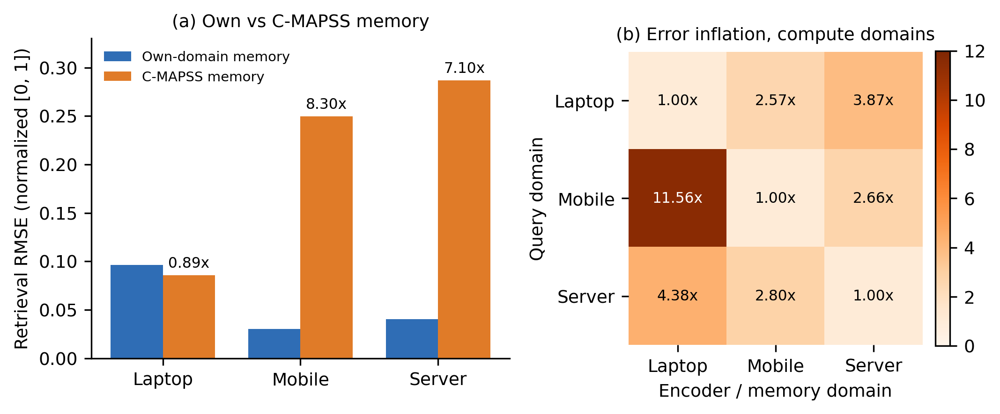
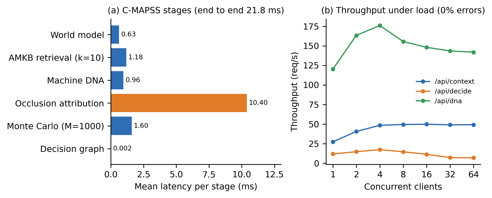

::: {custom-style="Author"}
[Author Name], [Co-author / Mentor Name]  
[Department], [Institution], [City, Country]  
[email address]
:::

::: {custom-style="Abstract"}
***Abstract*—Predictive-maintenance (PdM) systems usually stop at estimating remaining useful life (RUL), leaving open what to do about the estimate and why an operator should trust it. We present ATLAS, a modular platform that couples RUL prediction with memory-grounded explanation and cost-aware decision support, and that runs unchanged on different machines through a thin adapter layer. A recurrent world model with additive temporal attention encodes sensor windows into a shared 32-dimensional state; a vector-indexed memory of labeled run-to-failure experiences supplies neighbor citations, a calibrated confidence score and an uncertainty proxy; a Monte Carlo decision graph ranks four maintenance actions by expected cost under action-specific lead times. On NASA C-MAPSS FD001 the prediction engine reaches RMSE 15.22 ± 0.31 and PHM score 375.0 ± 21.9 over five seeds. Ablations show a 47.2% reduction in simulated fleet cost against a fixed-threshold rule with no missed imminent failures, and a Spearman correlation of −0.51 between grounded confidence and absolute error. Applying the architecture to laptop, mobile and server telemetry, a cross-domain study shows that learned representations are domain-specific: cross-domain memory retrieval inflates error 7–8× for two of three domains. End-to-end CPU latency is 21.8 ms per request. We also report 13 development defects, nearly all sharing one signature (a plausible output computed by the wrong method), and the regression guards that prevent them.**

***Index Terms*—predictive maintenance, remaining useful life, explainable AI, digital twin, decision support, cross-domain representation, industrial IoT.**
:::

# Introduction

Unplanned equipment failure is costly, and most deployed PdM systems stop at an RUL estimate or a threshold alarm. Operators are left with two questions: what to do about the estimate, given its uncertainty and the cost of acting too early or too late, and why the estimate deserves trust. Published RUL work on benchmarks such as NASA C-MAPSS [1] concentrates on point-prediction accuracy [2]–[5]. Interpretable and decision-aware variants exist [6], [7], but they are typically evaluated on a single dataset and a single machine type, and they rarely tie explanations to verifiable historical evidence.

ATLAS addresses the gap between prediction and decision with one architecture that (i) predicts RUL, (ii) grounds each prediction in citations to labeled historical cases, (iii) ranks maintenance actions by simulated expected cost, and (iv) runs unchanged on different machines through an adapter layer. The contributions are:

1. An integrated pipeline (world model, memory, explanation, Monte Carlo decision graph) evaluated end to end on C-MAPSS FD001 with multi-seed statistics.
2. A memory-grounding rule with a circularity guard: explanations may cite only neighbors carrying ground-truth labels, never the model's own predictions.
3. A lead-time-aware decision model with a deterministic ranking that breaks ties toward the safer action.
4. A four-domain study (turbofan, laptop, mobile, server) showing, with a distribution-distance metric and a retrieval diagnostic, that learned representations are domain-specific, including one result that looks like positive transfer but is not.
5. A verification methodology and defect catalogue (13 defects, 2 near-misses) with regression guards, and an adapter SDK whose conformance suite enforces those guards for new machine types.

We do not claim state-of-the-art RUL accuracy, validation on real run-to-failure data outside C-MAPSS, or production readiness (Section VI).

# Literature Review

**RUL prediction.** C-MAPSS [1] is the standard turbofan degradation benchmark and defines the asymmetric PHM score. Recurrent models set early baselines (an LSTM reports RMSE 16.14 on FD001 [2]). Attention-based approaches followed [3]; transformer architectures [4] and attention-LSTM variants with feature self-attention [5] report substantially lower RMSE on FD001 and FD003. These works optimise point accuracy; none connects the estimate to a maintenance action or to auditable evidence. Our prediction engine is deliberately simple (LSTM with additive attention [8]) because the contribution is the system around it.

**Interpretable and decision-aware PdM.** Özcan [6] couples interpretable ensemble RUL prediction with dynamic maintenance scheduling on C-MAPSS, the closest work to our scope. Cummins *et al.* [7] survey explainable PdM and identify the lack of standardized evaluation of explanation quality as an open challenge. Kobayashi and Alam [9] study explainable, trustworthy AI for an intelligent digital twin on RUL, using attribution to build operator trust. ATLAS differs in grounding explanations in a labeled case memory, in modelling action-specific lead times with Monte Carlo sampling, and in the multi-domain adapter design. Attribution uses perturbation (occlusion [10]) rather than SHAP [11] to stay model-agnostic and cheap on CPU.

**Memory and retrieval.** Retrieval of similar historical trajectories has a long history in similarity-based prognostics [12]. Retrieval- and memory-augmented designs motivate keeping experience in an external store rather than only in parametric weights. Our use differs in the labeling rule and in using retrieval for confidence and uncertainty, not only for prediction.

**Monte Carlo maintenance optimisation.** Monte Carlo simulation is an established tool for comparing maintenance strategies of degrading systems under uncertain lifetimes. ATLAS applies the idea at inference time: each recommendation is a Monte Carlo evaluation of four candidate actions with explicit lead times.

**Cross-domain transfer.** Domain adaptation for RUL is active: LAMA-Net [13] aligns latent representations with MMD [14] and manifold learning across C-MAPSS subsets, and transfer-component approaches [15] learn domain-invariant features. These methods study adaptation among *similar* machines (turbofan to turbofan). Whether representations transfer between *physically different* machine classes is rarely measured. We use MMD and centroid similarity as diagnostics, not as an adaptation method. MetroPT [16] provides real compressor data and is a planned validation target.

**Research gap.** From this review: (1) RUL models are evaluated as regressors, with no integrated path to a cost-aware action; (2) explanations are rarely grounded in verifiable labeled precedent, and their quality is seldom measured against prediction error; (3) systems are validated on one dataset, leaving cross-machine behaviour unmeasured; and (4) the software defects that produce plausible-but-wrong pipelines are not systematically catalogued. ATLAS targets all four with one open, reproducible architecture.

# Methodology and Architecture

Figure 1 shows the architecture. Data flows machine → adapter → world model → memory and Machine DNA → explanation → simulation → decision graph → (optional) agent safety gate, with a learning engine that retrains the world model offline.

{width=3.4in}

## Adapter Layer and Canonical Features

Every machine is reached through an adapter returning a normalized reading: domain, machine id, timestamp, a health index in [0,1], a feature dictionary, raw channels and an optional ground-truth RUL label. The adapter is the only place with domain-specific code; downstream components never branch on domain. Adapters exist for C-MAPSS (14 informative sensors after dropping 7 near-constant ones), laptop (psutil), Android mobile (Termux), server (SSH or calibrated simulation) and Modbus TCP; a conformance suite enforces the contract for any new adapter. The health index has two meanings: for C-MAPSS (Category A) it is degradation toward failure; for compute domains (Category B) it is instantaneous operational stress, not wear.

## World Model

A window of $L=30$ steps with $D$ canonical features passes through a two-layer LSTM (hidden size 64) giving $h_1,\dots,h_L$. Additive attention [8] computes

$$e_t = v_a^{\top}\tanh(W_a h_t + b_a),\quad \alpha_t=\frac{\exp(e_t)}{\sum_{j=1}^{L}\exp(e_j)},\quad c=\sum_{t=1}^{L}\alpha_t h_t qquad (1)$$

and a linear projection gives the 32-dimensional state

$$z = W_z c + b_z \in \mathbb{R}^{32}. qquad (2)$$

A linear head yields the RUL estimate, clamped at inference for physical non-negativity:

$$\hat{y} = \max\!\big(0,\; w^{\top} z + b\big). qquad (3)$$

RUL targets are clipped at 125 cycles. Training uses mean-squared error with Adam, a unit-level 80/20 split, early stopping, and a single evaluation on the official test set using the last window of each test unit.

## Adaptive Machine Knowledge Base (AMKB)

Experiences are stored in a pgvector index with domain, machine id, cycle, the 32-d state, the ground-truth RUL label and, separately, the model's predicted RUL. For a query state $z_q$ the cosine distance to a stored $z_i$ is

$$d(z_q,z_i)=1-\frac{z_q\cdot z_i}{\lVert z_q\rVert_2\,\lVert z_i\rVert_2}. qquad (4)$$

The $k=5$ nearest labeled neighbors are retrieved, excluding the query's own record. Only experiences with ground-truth labels may be cited (circularity guard). Retrieval is partitioned by domain key to avoid negative transfer.

## Machine DNA

A 16-d per-unit fingerprint summarizes degradation character (whole-life slopes of state norm and life-fraction health, thermal and speed sensor slopes, and terminal slopes over the last 20% of life). Each dimension is z-scored over the unit population, $\mathbf{z}_{\mathrm{DNA}}=(\mathbf{x}-\boldsymbol\mu)/\boldsymbol\sigma$, with persisted statistics applied identically to stored and query vectors.

## Explainability

Let $\bar d$ be the mean cosine distance to the retained neighbors and $\sigma^2$ the variance of their RUL labels. Confidence is

$$\mathcal{C}=\frac{1}{1+\bar d}\cdot\frac{1}{1+\sigma^{2}}, qquad (5)$$

bounded in $(0,1]$ with no division-by-zero. Attribution replaces sensor channel $j$ over the whole window by a reference value, re-runs the model, and records the change $\Delta_j = f(X)-f(X_{\setminus j})$; channels are ranked by $|\Delta_j|$. Explanation text is template-based, not LLM-generated.

## Monte Carlo Simulation and Decision Graph

Given estimate $\hat y$ and neighbor variance $\sigma^2$, draw $M=1000$ samples $y^{(m)}\sim\mathcal N(\hat y,\sigma^2)$ clipped to $[0,125]$. Four actions $a\in\mathcal A$ are evaluated (continue, schedule soon, schedule now, replace immediately) with lead times $\tau(a)=30,10,3,0$ cycles. The sample cost is

$$C(y,a)=\begin{cases}C_{f}, & y\le\tau(a)\\ 0, & y>\tau(a),\ a=\text{continue}\\ C_{b}+C_{d}\,u(a), & \text{otherwise}\end{cases} qquad (6)$$

with $C_f=1000$, $C_b=50$, $C_d=5$ and urgency multiplier $u(a)\in\{1,1.5,2\}$ (illustrative, not fitted to financial data). Expected cost, failure probability and cost dispersion are

$$\mathbb E[C(a)]=\tfrac1M\sum_m C(y^{(m)},a),\quad p_f(a)=\tfrac1M\sum_m \mathbb I\big(y^{(m)}\le\tau(a)\big),qquad (7)$$

$$\sigma_C(a)=\sqrt{\tfrac1M\sum_m\big(C(y^{(m)},a)-\mathbb E[C(a)]\big)^2}.qquad (8)$$

The recommendation is the lexicographic minimum

$$a^{*}=\arg\min_{a\in\mathcal A}\big(\mathbb E[C(a)],\,-p_f(a),\,\sigma_C(a),\,\mathrm{name}(a)\big), qquad (9)$$

so a cost tie favors the safer, more urgent action, and a safety override forces immediate replacement if $\hat y\le 10$ cycles or the health index is $\le0.20$.

## Learning Engine and Agent Safety Gate

Retraining is periodic and batch, not online. A candidate model replaces the active checkpoint only if its held-out RMSE is within the 3% tolerance of the active model (reflecting the 2–4% seed variance we measured); promotion is an atomic file replacement and every run is audited. A language-model assistant may propose work orders only through a structured tool requiring a live alert (under 24 h old, severity threshold), an exact fault-type match, an allowed action for that fault, and a server-stamped creator. Orders start as *Pending Approval* and become active only through a role-checked human approval; the agent has no function that actuates a machine.

# Experimental Setup

**Data.** C-MAPSS FD001 (100 training and 100 test engines, one operating condition, one fault mode) [1]. Laptop and mobile data come from the project's adapters; the server domain runs a calibrated simulation by default (an SSH path exists but was not exercised on real cloud hardware). Compute-domain encoders are pretrained by self-supervised next-step prediction on simulation profiles calibrated to real telemetry.

**Metrics.** RMSE and the asymmetric PHM score [1]:

$$S=\sum_{d_i<0}\big(e^{-d_i/13}-1\big)+\sum_{d_i\ge0}\big(e^{d_i/10}-1\big),\quad d_i=\hat y_i-y_i. qquad (10)$$

Cross-domain diagnostics are the maximum mean discrepancy [14] and the error inflation ratio

$$\mathrm{MMD}^2(P,Q)=\mathbb E[k(x,x')]-2\mathbb E[k(x,y)]+\mathbb E[k(y,y')],\qquad \mathrm{EIR}=\frac{\mathrm{RMSE}_{\mathrm{cross}}}{\mathrm{RMSE}_{\mathrm{within}}}. qquad (11)$$

Grounding quality is the Spearman correlation $r_s$ between $\mathcal C$ and $|\hat y-y|$.

**Protocol.** Five seeds (42–46), each with its own unit split and initialization; mean ± std is reported. Experiments ran CPU-only on one workstation (10 cores, 15.7 GB RAM, PyTorch 2.10 CPU). CPU training is not bit-reproducible; about ±0.3 RMSE should be expected on reruns.

# Results and Discussion

## RUL Prediction

Table I gives FD001 test-set accuracy.

: TABLE I. FD001 test-set accuracy.

| Model | RMSE | PHM score |
|:--|:--|:--|
| LSTM, linear head (5 seeds) | 15.34 ± 0.60 | 426.1 ± 83.6 |
| LSTM + attention (5 seeds) | 15.22 ± 0.31 | 375.0 ± 21.9 |
| LSTM from literature [2] | 16.14 | 338 |

Attention reduced the PHM coefficient of variation from 19.6% to 5.8% and slightly lowered RMSE. Our RMSE is lower than [2] but our PHM score is higher, meaning errors skew later; the comparison is directional, as implementations differ. More recent attention and transformer models [3]–[5] report lower RMSE, so we make no state-of-the-art claim: the prediction engine is intentionally a modest component. An earlier single run (RMSE 15.02) was a favorable seed, which is why multi-seed statistics are reported. Figures 2 and 3 show training loss and per-unit predictions.

{width=3.2in}

{width=3.2in}

## Decision-Value and Grounding Ablations

: TABLE II. Ablation results (FD001, 100 test units).

| Ablation | Baseline | ATLAS |
|:--|:--|:--|
| Total simulated cost | \$3,440.00 | \$1,817.50 (−47.17%) |
| Missed imminent failures (RUL ≤ 5) | 0 | 0 |
| Cost on 30 disputed units vs. threshold cascade | \$1,530 | \$1,370 (−10.46%) |
| Near-failure urgent response (RUL ≤ 15, n=10) | 100% | 90% |
| Confidence–error $r_s$ | undefined (constant 0.5) | −0.509 |
| Citation availability | 0% | 100% |

Against a fixed rule (replace below a 30-cycle estimate), the full pipeline cut simulated cost by 47.17% with no missed imminent failures under either policy; it schedules maintenance for 27 units and replaces 5, where the fixed rule replaces 24 (Fig. 4). The cost is premature replacement: 281 cycles of remaining life were discarded on 3 early-life units, where neighbor variance was large and the symmetric Gaussian placed tail mass near failure. This exposes a limitation of Gaussian uncertainty in early life. On near-failure units, 9 of 10 received urgent actions against 10 of 10 for the cascade, so the data show approximate safety parity, not a safety advantage; one unit (true RUL 14) was scheduled with only a 4-cycle margin. The negative $r_s=-0.509$ shows grounded confidence falls as error rises, which a constant ungrounded prior cannot do. Seeded results are reproducible, but near-tied expected costs remain sensitive to sampling in deployment; a deferral margin to a human is recommended.

{width=3.3in}

## Cross-Domain Study

MMD between C-MAPSS and each compute domain is about 1.23, against 0.90–0.93 among compute domains, so physical-degradation data separates cleanly from operational-load data (Fig. 5a). Centroid cosine similarities lie between −0.22 and 0.15, i.e. roughly orthogonal latent subspaces (Fig. 5b).

: TABLE III. Retrieval RMSE (normalized scale), within-domain vs. C-MAPSS memory.

| Domain | Within | Cross | EIR |
|:--|:--|:--|:--|
| Laptop | 0.0961 | 0.0858 | 0.89× |
| Mobile | 0.0301 | 0.2495 | 8.30× |
| Server | 0.0404 | 0.2868 | 7.10× |

Mobile and server show strong negative transfer. Laptop's ratio below 1 is *not* beneficial transfer: its within-domain baseline is weakest (four workload regimes), and out-of-distribution queries regress to the global label mean, which lies near the laptop mean; the latent distance gap (0.28 within vs. 10.82 across) confirms the queries are not semantically close. In a 3×3 compute-domain matrix every domain is best on its own encoder, with 2.57×–11.56× inflation elsewhere (Fig. 6). These results support domain-specific encoders bridged by a shared architecture, rather than one shared encoder.

{width=3.3in}

{width=3.3in}

## System Performance

: TABLE IV. CPU-only latency per request (mean over 100 trials).

| Stage / domain | Latency (ms) |
|:--|:--|
| World model (C-MAPSS) | 0.63 |
| pgvector retrieval (k=10, 17,737 vectors) | 1.18 |
| Occlusion attribution (14 passes) | 10.40 |
| Monte Carlo (1,000 rollouts) | 1.60 |
| End-to-end, C-MAPSS | 21.78 |
| End-to-end, laptop / mobile / server | 6.70 / 6.84 / 10.49 |

Occlusion attribution dominates; isolated stages sum to 14.8 ms and the remaining 7 ms is inter-stage overhead, chiefly checkouts from two separate database connection pools (a named optimization target). Context-endpoint throughput plateaued near 49 requests/s and the full decision endpoint peaked at 17.4 requests/s with no errors; isolated-process memory was about 282 MB (Fig. 7). Latency is far below standard industrial polling intervals (1–5 s).

{width=3.3in}

## Verification Methodology and Defects

We logged 13 defects and 2 near-misses; nearly all are a plausible result computed by the wrong method. Examples: a terminal ReLU zeroing RUL for about half of initializations; scoring all windows instead of the last per unit, which inflated a baseline RMSE to 48.8 against a true 15.4 and defeated a promotion gate; clipped and raw RUL scales mixed between subsystems; retrieval returning the query itself; an alphabetical tie-break favoring inaction; an inverted similarity sign; a live API silently routing three domains to an untrained fallback; and an unauthenticated path-traversal file read found only by an independent second review. Practices that caught them: cross-checking against a second measurement, reading raw artifacts, one permanent regression test per defect, hard-coded test thresholds, a queryable trained-or-not flag per domain, and labeling data as simulated, replayed, estimated or measured. The adapter conformance suite applies these checks to any new machine type.

# Limitations and Threats to Validity

Only one benchmark subset (FD001) is used. For laptop, mobile and server, memory holds no real run-to-failure cases, encoders are trained predominantly on simulation, and the server path is simulated by default; claims for these domains concern the architecture, not field accuracy. Health-index semantics differ between categories, so cross-domain similarity is a diagnostic, not proof of shared structure. The cost model is illustrative; savings are relative, not financial. Gaussian uncertainty is a simplification, domain-encoder results use one seed per domain, and the PHM score trails the cited baseline. Agent grounding validates structure, not the truth of free-text rationale; human approval remains the final barrier.

# Conclusion and Future Work

ATLAS shows that RUL prediction, memory-grounded explanation and cost-aware decisions can share one architecture across machine types, and that the main risks sit at the seams between components, which our verification practice targets. Future work: MC-dropout and ensemble uncertainty, multi-seed domain encoders, multi-condition C-MAPSS (FD002–FD004), a high-frequency vibration domain, validation on real industrial hardware and a cloud VM, and further protocol adapters (OPC-UA).

# References {.unnumbered}

::: {custom-style="Reference"}
[1] A. Saxena, K. Goebel, D. Simon, and N. Eklund, "Damage propagation modeling for aircraft engine run-to-failure simulation," in *Proc. Int. Conf. Prognostics and Health Management*, 2008.

[2] S. Zheng, K. Ristovski, A. Farahat, and C. Gupta, "Long short-term memory network for remaining useful life estimation," in *Proc. IEEE ICPHM*, 2017, pp. 88–95.

[3] Z. Chen, M. Wu, R. Zhao, F. Guretno, R. Yan, and X. Li, "Machine remaining useful life prediction via an attention-based deep learning approach," *IEEE Trans. Ind. Electron.*, vol. 68, no. 3, pp. 2521–2531, 2021.

[4] Q. Ma, M. Zhang, Y. Xu, J. Song, and T. Zhang, "Remaining useful life estimation for turbofan engine with transformer-based deep architecture," in *Proc. Int. Conf. Automation and Computing (ICAC)*, 2021.

[5] M. Dida, A. Cheriet, and M. Belhadj, "Remaining useful life prediction using attention-LSTM neural network of aircraft engines," *Int. J. Prognostics and Health Management*, 2025.

[6] H. Özcan, "Interpretable ensemble RUL prediction enables dynamic maintenance scheduling for aircraft engines," *Sci. Rep.*, 2025, doi:10.1038/s41598-025-23473-2.

[7] L. Cummins, A. Sommers, S. B. Ramezani, S. Mittal, J. Jabour, M. Seale, and S. Rahimi, "Explainable predictive maintenance: A survey of current methods, challenges and opportunities," *IEEE Access*, vol. 12, pp. 57574–57602, 2024, doi:10.1109/ACCESS.2024.3391130.

[8] D. Bahdanau, K. Cho, and Y. Bengio, "Neural machine translation by jointly learning to align and translate," in *Proc. ICLR*, 2015.

[9] K. Kobayashi and S. B. Alam, "Explainable, interpretable and trustworthy AI for intelligent digital twin: Case study on remaining useful life," arXiv:2301.06676, 2023.

[10] M. D. Zeiler and R. Fergus, "Visualizing and understanding convolutional networks," in *Proc. ECCV*, 2014.

[11] S. M. Lundberg and S.-I. Lee, "A unified approach to interpreting model predictions," in *Proc. NeurIPS*, 2017.

[12] T. Wang, J. Yu, D. Siegel, and J. Lee, "A similarity-based prognostics approach for remaining useful life estimation of engineered systems," in *Proc. Int. Conf. PHM*, 2008.

[13] M. Joseph and V. Lalwani, "LAMA-Net: Unsupervised domain adaptation via latent alignment and manifold learning for RUL prediction," arXiv:2208.08388, 2022.

[14] A. Gretton, K. M. Borgwardt, M. J. Rasch, B. Schölkopf, and A. Smola, "A kernel two-sample test," *J. Mach. Learn. Res.*, vol. 13, pp. 723–773, 2012.

[15] S. J. Pan, I. W. Tsang, J. T. Kwok, and Q. Yang, "Domain adaptation via transfer component analysis," *IEEE Trans. Neural Netw.*, vol. 22, no. 2, pp. 199–210, 2011.

[16] B. Veloso, R. P. Ribeiro, J. Gama, and P. M. Pereira, "The MetroPT dataset for predictive maintenance," *Sci. Data*, 2022, doi:10.1038/s41597-022-01877-3.
:::
