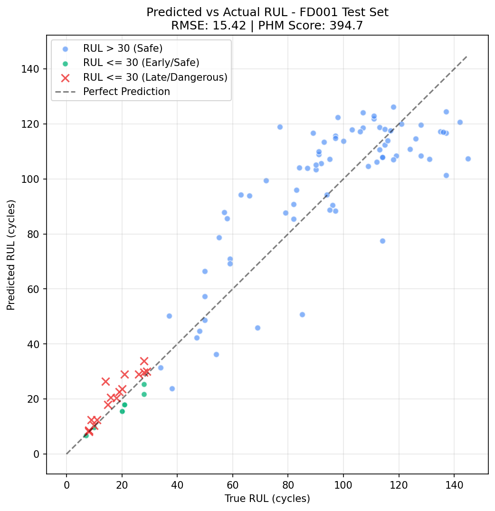

::: {custom-style="Author"}
[Author Name], [Co-author / Mentor Name]  
[Department], [Institution], [City, Country]  
[email address]
:::

::: {custom-style="Abstract"}
***Abstract*—Predictive-maintenance (PdM) systems usually stop at a remaining-useful-life (RUL) estimate, leaving open what to do about it and why to trust it. ATLAS couples RUL prediction with memory-grounded explanation and cost-aware decision support in one architecture shared across machine types through an adapter layer, with a per-domain encoder. An attention LSTM encodes sensor windows into a 32-dimensional state; a memory of labeled run-to-failure cases supplies citations and a dispersion-based confidence score; a Monte Carlo decision graph ranks four maintenance actions by expected cost under action-specific lead times. On NASA C-MAPSS FD001 the predictor reaches RMSE 15.22 ± 0.31 over five seeds, and on a simulated pump wear model 7.71 ± 0.27 cycles (constant-mean baseline: 40.5). The decision graph costs 47% less than a fixed 30-cycle threshold rule, a gap that comes from two units, but 7.2% more than a threshold rule tuned on held-out engines (95% CI: 5.8% less to 24.3% more), and more on all five retrained models. Confidence correlates with absolute error (Spearman −0.51) only through the spread of neighbor labels, and its intervals are not calibrated; masking the top-ranked sensors moves the estimate more than masking random ones for 89–94% of C-MAPSS units. On simulated compute telemetry, retrieval through another domain's encoder and memory inflates error 2.6–11.6×, so memory stays partitioned by domain. End-to-end CPU latency is 21.8 ms. We also report development defects and the guards that prevent them.**

***Index Terms*—predictive maintenance, remaining useful life, explainable AI, decision support, maintenance cost, industrial IoT.**
:::

# Introduction

Unplanned equipment failure is costly, and most deployed PdM systems stop at an RUL estimate or a threshold alarm. Operators are left with two questions: what to do about the estimate, given its uncertainty and the cost of acting too early or too late, and why the estimate deserves trust. Published RUL work on benchmarks such as NASA C-MAPSS [1] concentrates on point-prediction accuracy [2]–[5]. Interpretable and decision-aware variants exist [6], [7], but they are typically evaluated on a single dataset and a single machine type, and they rarely tie explanations to verifiable historical evidence.

ATLAS links prediction to decision with one architecture that predicts RUL, grounds each prediction in labeled historical cases, ranks maintenance actions by simulated expected cost, and is shared across machine types through adapters, with per-domain encoders and memory. The contributions are:

1. An integrated pipeline (world model, memory, explanation, Monte Carlo decision graph) evaluated end to end on C-MAPSS FD001 with multi-seed statistics.
2. A memory-grounding rule with a circularity guard: explanations may cite only neighbors carrying ground-truth labels, never the model's own predictions.
3. A lead-time-aware decision model with a deterministic, safety-first tie-break, evaluated against fixed, cascaded and tuned threshold rules with a cost breakdown and a sensitivity sweep.
4. A second degrading asset, a simulated motor pump, and a deletion test of attribution faithfulness on every domain.

We also report a cross-domain retrieval diagnostic on simulated compute telemetry and a catalogue of development defects. We claim neither state-of-the-art RUL accuracy, nor a cost advantage over a tuned threshold rule, nor validation on real run-to-failure data outside C-MAPSS (Section VI).

# Literature Review

**RUL prediction.** C-MAPSS [1] is the standard turbofan benchmark and defines the asymmetric prognostics and health management (PHM) score. A long short-term memory (LSTM) network reports a root-mean-square error (RMSE) of 16.14 on FD001 [2]; attention [3], transformer [4] and attention-LSTM [5] models report lower RMSE. These works optimise point accuracy and stop at the estimate. Our predictor is deliberately simple (LSTM with additive attention [8]); the contribution is the system around it.

**Interpretable and decision-aware PdM.** Özcan [6] couples interpretable ensemble RUL prediction with maintenance scheduling on C-MAPSS, the closest work to ours. Cummins *et al.* [7] note the lack of standardized evaluation of explanation quality, and Kobayashi and Alam [9] use attribution to build trust in a digital twin for RUL. Nguyen and Medjaher [10] turn LSTM prognostics into multi-horizon failure probabilities for maintenance planning, and de Pater *et al.* [11] schedule a fleet of C-MAPSS engines from alarms on imperfect prognostics. These optimise schedules over a horizon or a fleet; ATLAS makes a per-unit recommendation at each request and grounds it in a labeled case memory. Attribution uses occlusion [12] rather than SHAP [13] to stay model-agnostic and cheap.

**Uncertainty, memory and simulation.** Monte Carlo dropout [14] is a standard predictive-uncertainty method; ATLAS instead uses the label spread of retrieved neighbors, and we do not compare the two. Retrieval of similar trajectories underlies similarity-based prognostics [15], and retrieval-augmented models keep knowledge in an external store [16]; ATLAS uses retrieval for citations, confidence and uncertainty. Monte Carlo simulation is an established way to compare maintenance policies under uncertain lifetimes [17]; ATLAS applies it at each request.

**Cross-domain transfer.** LAMA-Net [18] aligns latent representations across C-MAPSS subsets with maximum mean discrepancy [19], and transfer component analysis [20] learns domain-invariant features; both adapt among similar machines. ATLAS does not adapt; it partitions memory by domain. MetroPT [21] is a planned real-data target.

# Methodology and Architecture

Figure 1 shows the architecture. Data flows machine → adapter → world model → memory and Machine DNA → explanation → simulation → decision graph → (optional) agent safety gate, with a learning engine that retrains the world model offline.

{width=3.2in}

## Adapter Layer and Canonical Features

Each machine is reached through an adapter that returns a normalized reading (domain, machine id, timestamp, health index in [0,1], features, raw channels, optional RUL label); only adapters contain domain-specific code. Adapters exist for C-MAPSS (14 informative sensors), laptop, Android mobile, server and Modbus TCP, including a motor pump whose simulator can run to failure; a profile-driven adapter onboards new assets, and a conformance suite checks every adapter. For C-MAPSS the health index is computed from the RUL label, $1-\min(\mathrm{RUL},125)/125$, so it is used only for display and Machine DNA and enters no reported result; for compute domains it measures operational stress, not wear.

## World Model

A window of $L=30$ steps with $D$ canonical features passes through a two-layer LSTM (hidden size 64) giving $h_1,\dots,h_L$. Additive attention [8] computes

$$e_t = v_a^{\top}\tanh(W_a h_t + b_a),\quad \alpha_t=\frac{\exp(e_t)}{\sum_{j=1}^{L}\exp(e_j)},\quad c=\sum_{t=1}^{L}\alpha_t h_t \qquad (1)$$

and a linear projection gives the 32-dimensional state

$$z = W_z c + b_z \in \mathbb{R}^{32}. \qquad (2)$$

A linear head yields the RUL estimate, clamped at zero:

$$\hat{y} = \max\!\big(0,\; w^{\top} z + b\big). \qquad (3)$$

RUL targets are clipped at 125 cycles. Training uses mean-squared error with Adam, a unit-level 80/20 split, early stopping, and a single evaluation on the official test set using the last window of each test unit.

## Adaptive Machine Knowledge Base (AMKB)

Experiences are stored in a pgvector index with domain, machine id, cycle, the 32-d state, the ground-truth RUL label and, separately, the model's predicted RUL. For a query state $z_q$ the cosine distance to a stored $z_i$ is

$$d(z_q,z_i)=1-\frac{z_q\cdot z_i}{\lVert z_q\rVert_2\,\lVert z_i\rVert_2}. \qquad (4)$$

At run time the $k=5$ nearest labeled neighbors are retrieved, excluding the query's own record. Only experiences with ground-truth labels may be cited (circularity guard). Retrieval is partitioned by domain key. In the ablations of Section V-B the memory holds the 20,631 windows of the 100 FD001 training engines, the queries are the last windows of the 100 test engines, a disjoint set of engines, and $k=10$; no test engine can therefore retrieve its own history.

## Machine DNA

A 16-d per-unit fingerprint of degradation slopes, z-scored over the unit population, supports similarity search between units; it is not used in the reported results.

## Explainability

Let $d_1,\dots,d_k$ be the cosine distances to the retained neighbors, $\bar s=\frac1k\sum_i 1/(1+d_i)$ their mean similarity, and $\sigma^2$ the variance of their RUL labels. Confidence is

$$\mathcal{C}=\bar s\cdot\frac{1}{1+\sigma^{2}}, \qquad (5)$$

Because $\sigma^2$ is in cycles² (typically $10^2$–$10^3$ here), $\mathcal C$ is small (mean 0.035 on the test set) and in effect a decreasing function of neighbor label spread: a ranking score, not a probability. Attribution occludes each sensor channel over the whole window and ranks channels by the change in $\hat y$. A C-MAPSS channel is set to 0, its training minimum after min-max scaling; other domains use the training population mean, since 0 is an extreme reading on their [0,1] scale. Explanation text is template-based.

## Monte Carlo Simulation and Decision Graph

Given estimate $\hat y$ and neighbor variance $\sigma^2$, draw $M=1000$ samples $y^{(m)}\sim\mathcal N(\hat y,\sigma^2)$ clipped to $[0,125]$. Four actions $a\in\mathcal A$ are evaluated (continue, schedule soon, schedule now, replace immediately) with lead times $\tau(a)=30,10,3,0$ cycles. The sample cost is

$$C(y,a)=\begin{cases}C_{f}, & y\le\tau(a)\\ 0, & y>\tau(a),\ a=\text{continue}\\ C_{b}+C_{d}\,u(a), & \text{otherwise}\end{cases} \qquad (6)$$

with $C_f=1000$, $C_b=50$, $C_d=5$ and urgency multiplier $u(a)\in\{1,1.5,2\}$ (illustrative). Expected cost, failure probability and cost dispersion are

$$\mathbb E[C(a)]=\tfrac1M\sum_m C(y^{(m)},a),\quad p_f(a)=\tfrac1M\sum_m \mathbb I\big(y^{(m)}\le\tau(a)\big),\qquad (7)$$

$$\sigma_C(a)=\sqrt{\tfrac1M\sum_m\big(C(y^{(m)},a)-\mathbb E[C(a)]\big)^2}.\qquad (8)$$

The recommendation is the lexicographic minimum

$$a^{*}=\arg\min_{a\in\mathcal A}\big(\mathbb E[C(a)],\,p_f(a),\,\sigma_C(a),\,\mathrm{name}(a)\big), \qquad (9)$$

so a cost tie favors the action with the lower failure probability. There is no separate hard safety override: Eq. (9) alone produces every recommendation reported here.

## Learning Engine and Agent Safety Gate

Retraining is batch and seeded, for every domain with a data source. A candidate is promoted only if its validation RMSE is within 3% of the best model ever promoted, so the tolerance cannot compound across runs. In 24 gated runs across five domains (three epochs each, on copies of the shipped checkpoints), 14 candidates were promoted and 10 rejected; the best C-MAPSS validation RMSE moved from 11.76 to 11.44. A language-model assistant can propose work orders only through a structured tool tied to a live alert and to an allowed action for its fault type; every order needs role-checked human approval, and the agent cannot actuate a machine. Inferences, decisions, promotions and work orders are written to an append-only, hash-chained audit log.

# Experimental Setup

**Data.** C-MAPSS FD001 (100 training and 100 test engines, one operating condition, one fault mode) [1]. A simulated motor-pump wear model generates run-to-failure data on six channels (temperature, vibration, current, speed, pressure, power factor): 100 training units (80/20 split by unit) and 50 held-out units cut at a random cycle, evaluated on the last 30-cycle window with truth capped at 125. The laptop, mobile and server results also use synthetic data only. For each domain a seeded generator produces 1,250 windows of 30 steps × 5 channels (e.g., CPU, memory, disk, battery, network); the first 1,000 form the memory and the last 250 the queries. Each domain's encoder is pretrained by next-step prediction on its own data. The retrieval label is a per-domain stress composite in [0,1] (e.g., laptop $0.7\,\mathrm{cpu}+0.3\,\mathrm{mem}$), not a time to failure.

**Metrics.** RMSE and the asymmetric PHM score [1]:

$$S=\sum_{d_i<0}\big(e^{-d_i/13}-1\big)+\sum_{d_i\ge0}\big(e^{d_i/10}-1\big),\quad d_i=\hat y_i-y_i. \qquad (10)$$

Grounding quality is the Spearman correlation $r_s$ between $\mathcal C$ and $|\hat y-y|$, with a 95% bootstrap confidence interval (2,000 resamples), plus the coverage of central intervals of $\mathcal N(\hat y,\sigma^2)$. Attribution faithfulness is a deletion test: mask the $k$ top-ranked sensors, and separately $k$ random sensors (mean of 20 draws), and count the units where the top-ranked mask moves $\hat y$ more ($k=1$ holds by construction). For compute domains a query is predicted as the mean label of its $k=5$ Euclidean nearest neighbors in the latent space of the encoder under test, and the error inflation ratio is

$$\mathrm{EIR}=\frac{\mathrm{RMSE}_{\mathrm{cross}}}{\mathrm{RMSE}_{\mathrm{within}}}. \qquad (11)$$

**Decision baselines.** (i) A fixed rule replaces when $\hat y<30$ and otherwise continues. (ii) A cascade replaces below 30 and schedules soon below 60. (iii) A tuned rule uses three thresholds (replace < schedule now < schedule soon) from $\{0,5,\dots,100\}$, chosen to minimise mean Eq. (6) cost on the checkpoint's 20 held-out validation engines, so no test outcome is used. All policies are charged by Eq. (6) against the true test RUL. A variant also charges discarded life, $C_\ell\,(y-\tau(a))$ per executed maintenance with $C_\ell=0.4$ per cycle. A sweep covers $C_f\in\{250,\dots,4000\}$, $\tau(\text{continue})\in\{15,20,30\}$ and $C_\ell\in\{0,0.4\}$, re-optimising the tuned rule and ATLAS each time. Savings carry a paired bootstrap 95% CI.

**Protocol.** Five seeds (42–46), each with its own unit split; mean ± std is reported. The ablations use the seed-46 checkpoint (RMSE 15.42, PHM 394.7; Fig. 2), and the grounding and decision analyses are repeated on five retrained checkpoints. All runs are CPU-only (10 cores, PyTorch 2.10); reruns vary by about ±0.3 RMSE.

# Results and Discussion

## RUL Prediction

Table I gives FD001 test-set accuracy.

: TABLE I. Test-set accuracy (FD001: 100 units; simulated pump: 50 held-out units).

| Model | RMSE | PHM score |
|:--|:--|:--|
| LSTM, linear head (5 seeds) | 15.34 ± 0.60 | 426.1 ± 83.6 |
| LSTM + attention (5 seeds) | 15.22 ± 0.31 | 375.0 ± 21.9 |
| LSTM from literature [2] | 16.14 | 338 |
| Pump, simulated (5 seeds) | 7.71 ± 0.27 | 42.4 ± 3.0 |
| Pump, constant-mean baseline | 40.51 | 13,440 |

Attention lowered the PHM coefficient of variation from 19.6% to 5.8%. Our RMSE is below [2] but our PHM score is higher (errors skew late); implementations differ, and newer models [3]–[5] report lower RMSE, so we claim no state of the art. An earlier single run (RMSE 15.02) was a favorable seed. The same architecture fits the simulated pump at 7.71 ± 0.27 cycles against 40.51 for predicting the training mean; this measures fit to our own simulator, not to real pumps.

{width=2.8in}

## Decision Value

: TABLE II. Decision policies on 100 FD001 test units (ablation checkpoint). Actions: continue/soon/now/replace; Fail.: lead-time failures; Disc.: remaining-life cycles discarded by executed maintenance; costs in \$, by Eq. (6) and with a discarded-life charge.

| Policy | Actions | Fail. | Disc. | Cost | + life |
|:--|:--|:--|:--|:--|:--|
| Fixed (< 30) | 76/0/0/24 | 2 | 424 | 3,440 | 3,610 |
| Cascade (30/60) | 65/11/0/24 | 0 | 845 | 2,045 | 2,383 |
| Tuned (10/20/45) | 70/17/8/5 | 0 | 470 | 1,695 | 1,883 |
| ATLAS | 68/14/13/5 | 0 | 718 | 1,817.50 | 1,812.30 |

In Table II, the fixed rule's \$3,440 is 24 replacements at \$60 plus two \$1,000 lead-time failures (units with true RUL 28 and 29 that it continued), so the 47% saving of ATLAS against it rests on two units. Against the tuned rule, fixed before any test outcome was seen, ATLAS costs 7.2% more (paired bootstrap 95% CI: 5.8% less to 24.3% more): it replaces 5 units with 296 cycles of remaining life, three of them in early life, where neighbor variance was large and the Gaussian put tail mass near failure. Charging discarded life reverses the sign (ATLAS costs 3.8% less; 95% CI: 0.9% more to 12.0% less) because ATLAS then replaces only 2 units. Over the 30 sweep settings ATLAS beats the tuned rule in 12 (median −3.1%), the fixed rule in 18 and the cascade in 22 (Fig. 3b). On five retrained checkpoints it saves 25–73% against the fixed rule but costs 7–216% more than the tuned rule, and on two it has lead-time failures of its own (seed 44: three units continued at true RUL 21–29; seed 45: one scheduled soon at true RUL 10). We therefore claim no cost advantage over a tuned rule; the decision graph differs in needing costs and lead times rather than labeled data to set its thresholds.

On the 10 near-failure units (true RUL ≤ 15) ATLAS acted urgently on 9 and the cascade on 10; one unit (true RUL 14) was scheduled soon with a 4-cycle margin. This is approximate safety parity, not an advantage.

{width=3.4in}

## Grounding and Confidence

: TABLE III. Spearman $r_s$ between a score and absolute error (100 test units; 95% bootstrap CI).

| Score | Ablation checkpoint | Five retrained checkpoints |
|:--|:--|:--|
| $\mathcal C$, Eq. (5) | −0.51 [−0.66, −0.33] | −0.45 ± 0.04 |
| $\mathcal C$ with $\sigma^2/125^2$ | −0.51 [−0.66, −0.33] | −0.45 ± 0.04 |
| Neighbor label spread only ($-\sigma$) | −0.51 [−0.66, −0.33] | −0.45 ± 0.04 |
| Prediction only ($-\hat y$, no memory) | −0.45 [−0.61, −0.26] | −0.43 ± 0.04 |

Confidence falls as error rises, but its ranking equals that of neighbor label spread alone, and the prediction itself ranks errors almost as well (Table III). The ungrounded baseline, a constant 0.5, has no defined $r_s$. The Monte Carlo intervals cover the true RUL for 63%, 85%, 87% and 91% of units at nominal 50%, 80%, 90% and 95% (similar across seeds), so neither the score nor the intervals are calibrated; we use $\mathcal C$ only to rank predictions. Every explanation cites labeled neighbors by construction, which is not evidence of explanation quality. In the deletion test, masking the top-ranked C-MAPSS sensors moves $\hat y$ more than masking random ones for 90%, 94% and 89% of units at $k$ = 2, 3 and 5 (mean change 35.4 vs. 16.8 cycles at $k=2$), for 82%, 82% and 70% on the simulated pump, and for 63–73% on the compute domains at $k$ = 2–3, so attribution is faithful on the degrading assets and weaker on the compute domains.

## Cross-Domain Retrieval Diagnostic

This diagnostic asks only whether retrieval can share memory across domains; the compute domains have no failures, and their labels measure stress. In a 3×3 matrix, queries of one domain are encoded by a second domain's encoder and matched to that domain's memory and labels, so query and memory share one latent space. Each domain is best on its own encoder and memory (within-domain RMSE 0.096 laptop, 0.030 mobile, 0.040 server). The other cells inflate error 2.57–11.56× (worst: mobile queries on the laptop encoder). Because foreign labels are different stress composites, part of this is built in: the result confirms that memory must stay partitioned by domain, not that the representations differ intrinsically. An earlier draft also compared C-MAPSS and compute latents by maximum mean discrepancy, cosine similarity and retrieval; those comparisons put vectors from independently trained encoders in one space, so we removed them.

## System Performance

: TABLE IV. CPU-only latency per request (mean over 100 trials).

| Stage / domain | Latency (ms) |
|:--|:--|
| World model (C-MAPSS) | 0.63 |
| pgvector retrieval (k=10, 17,737 vectors) | 1.18 |
| Machine DNA lookup | 0.96 |
| Occlusion attribution (14 passes) | 10.40 |
| Monte Carlo (1,000 rollouts) | 1.60 |
| End-to-end, C-MAPSS | 21.78 |
| End-to-end, laptop / mobile / server | 6.70 / 6.84 / 10.49 |

Occlusion attribution dominates latency (Table IV); isolated stages sum to 14.8 ms, and the remaining 7 ms is inter-stage overhead, chiefly checkouts from two database connection pools. Throughput peaked at 49 requests/s for context and 17.4 requests/s for full decisions, with no errors, at about 282 MB of process memory.

## Development Defects and Guards

We logged 13 defects and 2 near-misses as they were found (a record of practice, not a controlled study); nearly all were a plausible result computed by the wrong method. Table V lists six. Others: scoring all windows instead of the last per unit (baseline RMSE 48.8 instead of 15.4), mixed clipped and raw RUL scales, and retrieval returning the query itself. Three more followed the register: the manuscript described a safety override that the code lacks; live laptop, phone and server windows reached their models in alphabetical rather than training column order; and C-MAPSS retraining scored its gate on z-scored data while the model is served min-max-scaled windows. Each defect now has a permanent regression test, and the adapter conformance suite applies these checks to new machine types.

: TABLE V. Selected defects, how each was detected, and the guard that now prevents it.

| Defect | Detected by | Guard |
|:--|:--|:--|
| ReLU output head zeroed RUL for some initializations | Identical zero outputs across seeds | Multi-seed output-range test |
| Cosine distance used as similarity, inverting confidence | Confidence–error sanity check | Sign test; $r_s$ reported |
| Alphabetical tie-break favored inaction | Equal-cost borderline cases | Tie-break order test, Eq. (9) |
| Cross-domain distances tracked padded dimensions | Implausibly uniform distances | Transfer-study unit test |
| Live API used untrained fallback encoders | Live output vs. evaluation harness | Per-domain trained flag and test |
| Path traversal in static file serving | Independent security review | Traversal-payload test suite |

# Limitations and Threats to Validity

Only FD001 is used. Pump and compute-domain results are synthetic; the pump RMSE measures fit to our own simulator, and the compute domains have no failures. Costs, lead times and urgency multipliers are illustrative, and the decision graph does not beat a tuned threshold rule. Confidence is uncalibrated and not compared with Monte Carlo dropout or ensembles. The C-MAPSS health index is label-derived, no hard safety override exists, domain encoders have one seed each, and the PHM score trails [2]. Agent grounding checks structure, not the truth of free text; human approval is the final barrier.

# Conclusion and Future Work

ATLAS shows that RUL prediction, memory-grounded explanation and cost-aware decisions can share one architecture across machine types when encoders and memory stay per domain. Under illustrative costs its decision graph beats fixed and cascaded rules but not a tuned threshold rule, and its confidence ranks errors without being calibrated. Future work: real cost and lead-time data, calibrated uncertainty, a sensor-based health index, multi-condition C-MAPSS (FD002–FD004), and validation on real pumps and other industrial hardware.

# Code and Data Availability {.unnumbered}

C-MAPSS is publicly available [1]. The ATLAS code, trained checkpoints and the scripts that regenerate Tables I–V are available from the authors on request.

# References {.unnumbered}

::: {custom-style="Reference"}
[1] A. Saxena, K. Goebel, D. Simon, and N. Eklund, "Damage propagation modeling for aircraft engine run-to-failure simulation," in *Proc. Int. Conf. Prognostics and Health Management*, 2008.

[2] S. Zheng, K. Ristovski, A. Farahat, and C. Gupta, "Long short-term memory network for remaining useful life estimation," in *Proc. IEEE ICPHM*, 2017, pp. 88–95.

[3] Z. Chen, M. Wu, R. Zhao, F. Guretno, R. Yan, and X. Li, "Machine remaining useful life prediction via an attention-based deep learning approach," *IEEE Trans. Ind. Electron.*, vol. 68, no. 3, pp. 2521–2531, 2021.

[4] Q. Ma, M. Zhang, Y. Xu, J. Song, and T. Zhang, "Remaining useful life estimation for turbofan engine with transformer-based deep architecture," in *Proc. Int. Conf. Automation and Computing (ICAC)*, 2021.

[5] M. Dida, A. Cheriet, and M. Belhadj, "Remaining useful life prediction using attention-LSTM neural network of aircraft engines," *Int. J. Prognostics and Health Management*, 2025.

[6] H. Özcan, "Interpretable ensemble RUL prediction enables dynamic maintenance scheduling for aircraft engines," *Sci. Rep.*, 2025, doi:10.1038/s41598-025-23473-2.

[7] L. Cummins, A. Sommers, S. B. Ramezani, S. Mittal, J. Jabour, M. Seale, and S. Rahimi, "Explainable predictive maintenance: A survey of current methods, challenges and opportunities," *IEEE Access*, vol. 12, pp. 57574–57602, 2024, doi:10.1109/ACCESS.2024.3391130.

[8] D. Bahdanau, K. Cho, and Y. Bengio, "Neural machine translation by jointly learning to align and translate," in *Proc. ICLR*, 2015.

[9] K. Kobayashi and S. B. Alam, "Explainable, interpretable and trustworthy AI for intelligent digital twin: Case study on remaining useful life," arXiv:2301.06676, 2023.

[10] K. T. P. Nguyen and K. Medjaher, "A new dynamic predictive maintenance framework using deep learning for failure prognostics," *Reliab. Eng. Syst. Saf.*, vol. 188, pp. 251–262, 2019, doi:10.1016/j.ress.2019.03.018.

[11] I. de Pater, A. Reijns, and M. Mitici, "Alarm-based predictive maintenance scheduling for aircraft engines with imperfect Remaining Useful Life prognostics," *Reliab. Eng. Syst. Saf.*, vol. 221, art. 108341, 2022, doi:10.1016/j.ress.2022.108341.

[12] M. D. Zeiler and R. Fergus, "Visualizing and understanding convolutional networks," in *Proc. ECCV*, 2014.

[13] S. M. Lundberg and S.-I. Lee, "A unified approach to interpreting model predictions," in *Proc. NeurIPS*, 2017.

[14] Y. Gal and Z. Ghahramani, "Dropout as a Bayesian approximation: Representing model uncertainty in deep learning," in *Proc. ICML*, PMLR vol. 48, 2016, pp. 1050–1059.

[15] T. Wang, J. Yu, D. Siegel, and J. Lee, "A similarity-based prognostics approach for remaining useful life estimation of engineered systems," in *Proc. Int. Conf. PHM*, 2008.

[16] P. Lewis *et al.*, "Retrieval-augmented generation for knowledge-intensive NLP tasks," in *Proc. NeurIPS*, 2020.

[17] M. Marseguerra and E. Zio, "Optimizing maintenance and repair policies via a combination of genetic algorithms and Monte Carlo simulation," *Reliab. Eng. Syst. Saf.*, vol. 68, no. 1, pp. 69–83, 2000, doi:10.1016/S0951-8320(00)00007-7.

[18] M. Joseph and V. Lalwani, "LAMA-Net: Unsupervised domain adaptation via latent alignment and manifold learning for RUL prediction," arXiv:2208.08388, 2022.

[19] A. Gretton, K. M. Borgwardt, M. J. Rasch, B. Schölkopf, and A. Smola, "A kernel two-sample test," *J. Mach. Learn. Res.*, vol. 13, pp. 723–773, 2012.

[20] S. J. Pan, I. W. Tsang, J. T. Kwok, and Q. Yang, "Domain adaptation via transfer component analysis," *IEEE Trans. Neural Netw.*, vol. 22, no. 2, pp. 199–210, 2011.

[21] B. Veloso, R. P. Ribeiro, J. Gama, and P. M. Pereira, "The MetroPT dataset for predictive maintenance," *Sci. Data*, 2022, doi:10.1038/s41597-022-01877-3.
:::
